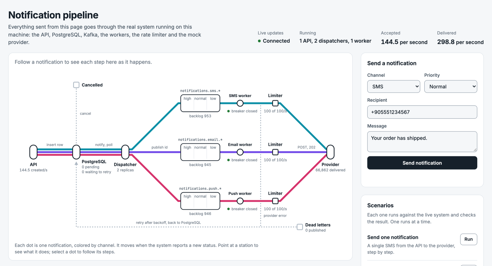

<h1 align="center">Notification System</h1>

<p align="center">
  An event-driven SMS, email and push notification service in Go: it accepts bursts over HTTP,
  delivers at 100 messages per second per channel, retries what fails and streams every status
  change live.
</p>

<p align="center">
  <a href="https://github.com/alpermelkeli/notification-system/actions/workflows/ci.yml"></a>
  <a href="go.mod"></a>
  <a href="docs/adr/0001-architecture-overview.md"></a>
  <a href="docs/adr/0002-kafka-topology-and-consumer-model.md"></a>
  <a href="docs/adr/0006-rate-limiting-and-priority-scheduling.md"></a>
  <a href="api/openapi.yaml"></a>
  <a href="#load-test-results"></a>
</p>

<p align="center">
  <picture>
    <source media="(prefers-color-scheme: dark)" srcset="docs/images/playground-dark.png">
    
  </picture>
</p>

## Run it

You need Docker with Compose v2.

```bash
docker compose up --build      # or: make up
```

Then open **http://localhost:8080/playground**. It draws the whole pipeline, moves each
notification along it as it happens, and has buttons that run scenarios against the live system:
a burst of 1000, priorities, scheduling, templates, retries, a provider outage, dead letters.

| What | Where |
|------|-------|
| Playground | http://localhost:8080/playground |
| Live status demo (WebSocket) | http://localhost:8080/ws-demo |
| API reference (Swagger UI) | http://localhost:8080/docs |
| Traces (Jaeger) | http://localhost:16686 |
| Metrics (Prometheus) | http://localhost:9091 |

By default the workers deliver to a local mock of webhook.site. To use the real one, set it to
answer `202`, put `PROVIDER_URL=https://webhook.site/<your-uuid>` in a `.env` file and restart.
The playground's failure scenarios then turn off, since they work by making the mock fail.

## What it does

- **API:** create one notification or a batch of up to 1000, look up status by notification or
  batch, cancel, list with filters, replay a failed one.
- **Delivery:** high, normal and low priority; 100 messages per second per channel across all
  workers; content checked per channel; no duplicate sends (`Idempotency-Key`).
- **Failures:** retries with exponential backoff and jitter, permanent errors told apart from
  temporary ones, dead letters, and a circuit breaker during provider outages.
- **Visibility:** Prometheus metrics, JSON logs with correlation ids, health checks, one trace per
  notification, live status over WebSocket.
- **Extras:** scheduled delivery, `{{variable}}` templates, CI on GitHub Actions.

## How it works


1. The **API** checks the request, saves it in **PostgreSQL** and answers `202 Accepted`.
2. The **dispatcher** picks up rows that are due (new, scheduled or retrying) and puts their ids on
   **Kafka**, one topic per channel and priority.
3. A **worker** per channel takes the most urgent message, waits for a slot from the **Redis**
   rate limiter, and calls the **provider**.
4. The result goes back to PostgreSQL. A failure is retried later or ends as a dead letter.
5. Every status change is published as an event, and the API streams it to WebSocket clients.

PostgreSQL is the source of truth and decides *when*; Kafka moves the work; Redis keeps the rate.
Each part can run as several copies (`make up-scaled` runs three APIs and three workers). The main
decisions:

| Decision | Why | ADR |
|----------|-----|-----|
| PostgreSQL for state, Kafka for distribution | durable state and timing in one place, scalable fan-out to workers | [0001](docs/adr/0001-architecture-overview.md) |
| The notifications table is the outbox | no message is lost or published twice between the database and Kafka | [0003](docs/adr/0003-dispatch-without-separate-outbox.md) |
| Idempotency at every hop | a retried request, a redelivered message or a crashed worker does not send twice | [0004](docs/adr/0004-idempotency.md) |
| Shared token bucket in Redis | the 100/s limit holds however many workers run | [0006](docs/adr/0006-rate-limiting-and-priority-scheduling.md) |

More in [How it works](docs/how-it-works.md) and the [ADRs](docs/adr/).

## Try the API

```bash
# Send one notification
curl -XPOST localhost:8080/v1/notifications -H 'Content-Type: application/json' \
  -d '{"recipient":"+905551234567","channel":"sms","content":"Your code is 482913","priority":"high"}'
# 202 {"id":"01a1fd17-...","status":"pending",...}

# Check its status, and every step it went through
curl localhost:8080/v1/notifications/<id>
curl localhost:8080/v1/notifications/<id>/history

# Send a batch
curl -XPOST localhost:8080/v1/notifications/batch -H 'Content-Type: application/json' -d '{
  "notifications": [
    {"recipient":"user@example.com","channel":"email","content":"Flash sale!","priority":"low"},
    {"recipient":"fcm-token-123456","channel":"push","content":"Flash sale!","priority":"low"}]}'
curl localhost:8080/v1/batches/<batchId>

# Follow status changes live over WebSocket (or open http://localhost:8080/ws-demo)
websocat ws://localhost:8080/v1/ws
{"type":"subscribe","notificationIds":["<id>"],"batchIds":["<batchId>"]}
# {"type":"status","snapshot":true,"event":{"notificationId":"<id>","status":"queued",...}}
# {"type":"status","event":{"notificationId":"<id>","status":"sent","attempts":1,...}}
```

Every endpoint, scheduling and templates: [API guide](docs/api.md) and
[`api/openapi.yaml`](api/openapi.yaml). The WebSocket protocol and its limits:
[How it works](docs/how-it-works.md#live-status-updates).

## Develop and test

Go 1.26+ is needed only for local development.

```bash
make test        # all tests with the race detector (integration tests start containers)
make test-short  # unit tests only, no Docker
make lint        # golangci-lint
make loadtest    # 30 000 notifications against the running stack, checked against the capacity plan
make help        # every target: run a single role, infrastructure only, logs, ...
```

## Learn more

| Document | Contents |
|----------|----------|
| [How it works](docs/how-it-works.md) | Processing engine, live updates, observability, data model, scaling |
| [API guide](docs/api.md) | Endpoints, examples, validation rules, scheduling, templates, errors |
| [Configuration](docs/configuration.md) | Compose services and every environment variable |
| [Testing](docs/testing.md) | What the unit and integration tests cover |
| [Capacity planning](docs/capacity-planning.md) | Back-of-the-envelope numbers |
| [Requirements](docs/requirements.md) | The brief's requirements and where each is implemented |
| [ADRs](docs/adr/) | Architecture decisions |

## Load test results

`make loadtest` sends 30 000 notifications (10 000 per channel) to the running stack in one burst,
measures it and checks it against the [capacity plan](docs/capacity-planning.md#measured). Every
check passes, with one API and one worker and with three of each (`make up-scaled`):

| Check | Target | 1 API, 1 worker | 3 APIs, 3 workers | |
|-------|--------|-----------------|-------------------|---|
| Burst accepted by the API | ≥ 5 000/s | 27 000–40 000/s | 20 000–27 000/s | ✅ |
| Delivery per channel | 100/s | 98.5–99.9/s | 97.5–99.6/s | ✅ |
| 10 000 per channel drained | 100 s | 101–102 s | 101–103 s | ✅ |
| Every notification sent, none lost | 30 000 | 30 000 | 30 000 | ✅ |
| `high` priority, created to sent (p99) | < 1 s | 210–385 ms | 200–230 ms | ✅ |
| `high` right behind the 30 000, p99 | < 1 s | 240–310 ms | 260–300 ms | ✅ |

The rate limiter grants exactly 100 slots per second per channel, shared by every worker; the
busiest second at the provider held 100 requests (101 now and then, from network jitter). Three replicas are not faster than one, because delivery is
capped by that limit; they add fault tolerance. With one of three workers stopped in the middle
of the drain, every notification was still sent in the same time.

