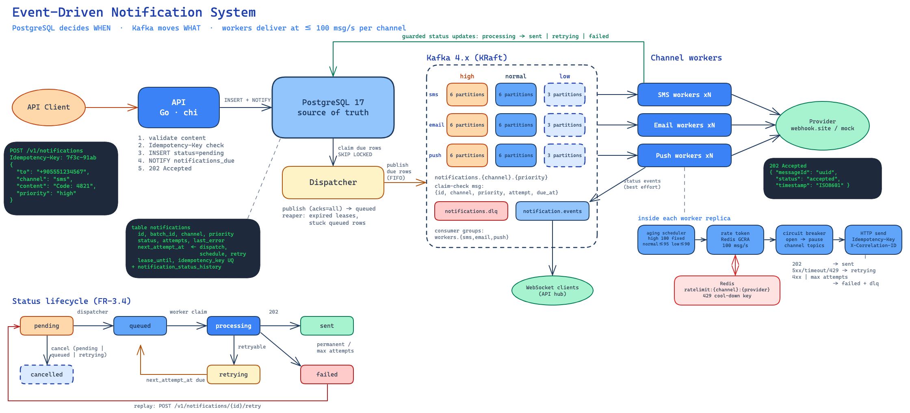
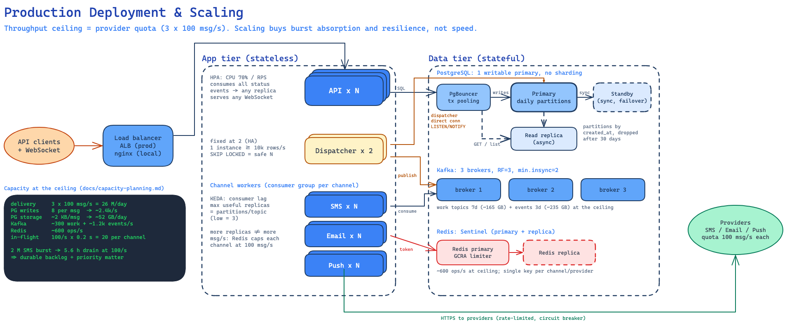

# Notification System

An event-driven, multi-channel notification service written in Go. It accepts notification
requests over HTTP, processes them asynchronously through prioritized queue workers, and delivers
them via SMS, Email and Push providers with rate limiting, retries and real-time status tracking.

> **Status:** 🚧 Architecture decided (see [ADRs](docs/adr/)); implementation starting. See [`docs/plan.md`](docs/plan.md).

## Features (target)
- **Notification API:** single and batch create (up to 1000), status by ID / batch ID, cancel, filtered + paginated listing
- **Processing engine:** async workers, high / normal / low priority queues, 100 msg/s per channel rate limit, content validation, idempotency
- **Delivery & retry:** exponential backoff with jitter, failure classification, dead-letter handling
- **Observability:** metrics endpoint (queue depth, success/failure rates, latency), structured logs with correlation IDs, health checks
- **Bonus:** scheduled notifications, templates, WebSocket status updates, distributed tracing, CI/CD

## Quick start
_Coming in Phase 2._
```bash
cp .env.example .env        # set PROVIDER_URL to your webhook.site URL
docker compose up --build
```

## Architecture



> Editable source: [`docs/architecture/architecture.excalidraw`](docs/architecture/architecture.excalidraw) (open with [excalidraw.com](https://excalidraw.com)).

**PostgreSQL decides *when*, Kafka moves *what*, workers deliver at ≤ 100 msg/s per channel.**

1. **API** validates the request, enforces `Idempotency-Key`, inserts the notification
   (`status=pending`) and returns `202 Accepted`. It never talks to Kafka directly.
2. **Dispatcher** claims due rows (`FOR UPDATE SKIP LOCKED`, FIFO by `next_attempt_at`), publishes
   them to Kafka and marks them `queued`. The same mechanism handles new, scheduled and retrying
   notifications.
3. **Kafka** carries claim-check messages on 9 work topics (`notifications.{channel}.{priority}`),
   plus `notifications.dlq` and `notification.events`.
4. **Channel workers** (one consumer group per channel) buffer records per priority and pick the
   next one with a **capped-aging scheduler**. `high` is never overtaken, while `normal`/`low` age
   and get a guaranteed minimum share. Each send takes a token from the shared **Redis** rate
   limiter, passes a per-channel circuit breaker, and the outcome is written back with a guarded
   status transition.
5. **Status events** stream to `notification.events` for WebSocket clients.

### Design decisions
| ADR | Decision |
|-----|----------|
| [0001](docs/adr/0001-architecture-overview.md) | PostgreSQL as source of truth + Kafka as delivery backbone |
| [0002](docs/adr/0002-kafka-topology-and-consumer-model.md) | Channel × priority topics, classic consumer groups, `franz-go` |
| [0003](docs/adr/0003-dispatch-without-separate-outbox.md) | The notifications table is the outbox; FIFO dispatcher + reaper |
| [0004](docs/adr/0004-idempotency.md) | Idempotency-Key at the API, guarded claim at the worker, provider idempotency header |
| [0005](docs/adr/0005-delivery-retry-and-failure-handling.md) | Status lifecycle, failure classification, backoff + jitter, DLQ, circuit breaker |
| [0006](docs/adr/0006-rate-limiting-and-priority-scheduling.md) | Redis GCRA per channel/provider, 429 fleet cool-down, capped-aging priority scheduler |
| [0007](docs/adr/0007-technology-stack.md) | Go 1.25, chi, pgx, goose, franz-go, go-redis, OpenTelemetry, testcontainers |
| [0008](docs/adr/0008-scalability-and-deployment-topology.md) | Scaling model per component, single PG primary + HA/replica/partitioning, nginx scaling demo |

## Scalability & capacity



**The throughput ceiling is the provider quota:** 3 channels × 100 msg/s = 300 msg/s ≈ 26 M/day.
Adding replicas or database capacity cannot raise it, so scaling serves **burst absorption**
(API), **resilience** (every tier) and **provider-latency concurrency** (workers). The full
back-of-the-envelope math is in [`docs/capacity-planning.md`](docs/capacity-planning.md).

| At the ceiling | Value |
|----------------|-------|
| PostgreSQL writes | ~2.4 k/s (8 per notification), single primary is enough |
| PostgreSQL storage | ~2 KB/notification → ~52 GB/day, daily partitions + 30-day retention |
| Kafka | ~1.5 k msg/s (work + events), 3 brokers RF=3 |
| Redis | ~600 ops/s |
| Burst drain | 2 M SMS ≈ 5.6 h at 100 msg/s, so the backlog stays durable in Kafka and priority matters |

| Component | Scales by | Autoscaling signal |
|-----------|-----------|--------------------|
| API | horizontal behind LB (stateless) | CPU / RPS |
| Dispatcher | horizontal (`SKIP LOCKED`), 2 for HA | none |
| Workers | consumer group per channel | Kafka consumer lag (max = partitions) |
| PostgreSQL | vertical + sync standby + read replica + partitioning | none (no sharding needed) |

Scaling demo (local):
```bash
docker compose up --build --scale api=3 --scale worker=3
```
nginx (`lb`, port 8080) spreads requests across API replicas, and Kafka splits partitions across
worker replicas, while each channel still sends at most 100 msg/s. See
[ADR-0008](docs/adr/0008-scalability-and-deployment-topology.md).

**Delivery guarantee:** at-least-once with deduplication at every hop. The only remaining
duplicate window is a worker crash after the provider accepted a request but before the outcome
was persisted (see ADR-0004).

## API
_OpenAPI spec and examples coming in Phase 4._

## Configuration
_Environment variables documented in Phase 2._

## Testing
_`make test` — coming in Phase 2._

## Project docs
| Path | Contents |
|------|----------|
| [`docs/requirements.md`](docs/requirements.md) | Requirements & traceability checklist |
| [`docs/plan.md`](docs/plan.md) | Delivery plan & open questions |
| [`docs/conventions.md`](docs/conventions.md) | Engineering conventions |
| [`docs/adr/`](docs/adr/) | Architecture Decision Records |
| [`docs/architecture/`](docs/architecture/) | Architecture and deployment diagrams (Excalidraw source + PNG) |
| [`docs/capacity-planning.md`](docs/capacity-planning.md) | Back-of-the-envelope capacity math |
| [`.claude/agents/`](.claude/agents/) | Claude Code subagents used for parallel development |
