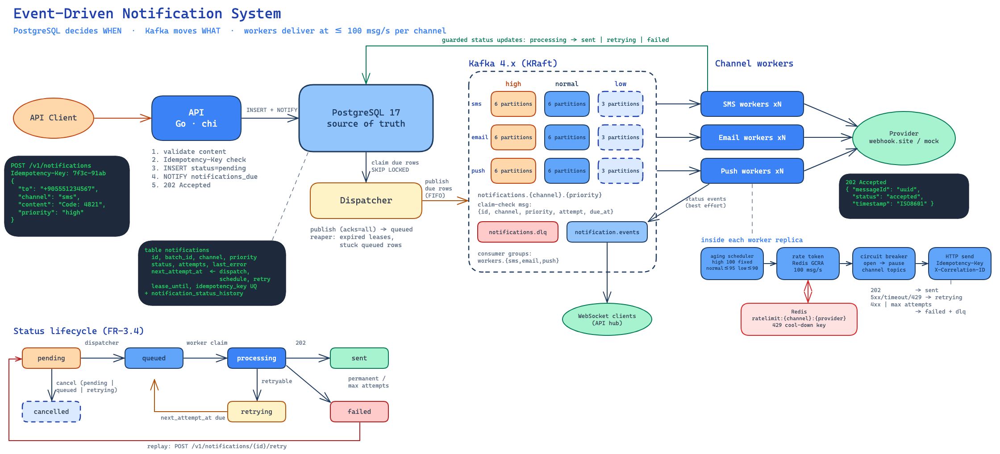
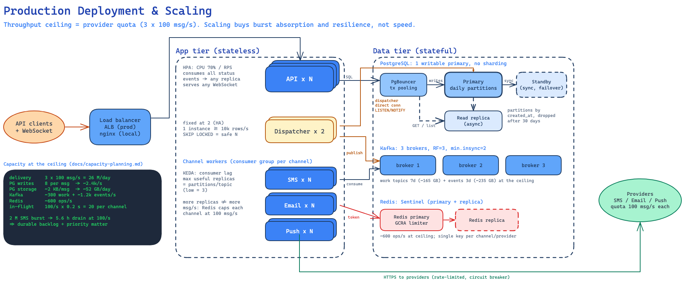

# How it works

The details behind the README's overview: the processing engine, live status updates,
observability, the data model and scaling. The decisions themselves are in the [ADRs](adr/).

## Overview



> Editable source: [`docs/architecture/architecture.excalidraw`](architecture/architecture.excalidraw) (open with [excalidraw.com](https://excalidraw.com)).

**PostgreSQL decides *when*, Kafka moves *what*, workers deliver at ≤ 100 msg/s per channel.**

1. **API** validates the request, enforces `Idempotency-Key`, inserts the notification
   (`status=pending`) and returns `202 Accepted`. It never publishes work to Kafka; the
   dispatcher does.
2. **Dispatcher** claims due rows (`FOR UPDATE SKIP LOCKED`, FIFO by `next_attempt_at`), publishes
   them to Kafka and marks them `queued`. The same mechanism handles new, scheduled and retrying
   notifications.
3. **Kafka** carries claim-check messages on 9 work topics (`notifications.{channel}.{priority}`),
   plus `notifications.dlq` and `notification.events`.
4. **Channel workers** (one consumer group per channel) buffer records per priority and pick the
   next one with a **capped-aging scheduler**. `high` is never overtaken, while `normal`/`low` age
   and get a guaranteed minimum share. Each send takes a token from the shared **Redis** rate
   limiter, passes a per-channel circuit breaker (Phase 6), and the outcome is written back with a
   guarded status transition.
5. **Status events:** every component publishes the rows it changed to `notification.events`
   after the commit (best effort, [ADR-0011](adr/0011-status-events-and-websocket.md)), and
   every API instance fans them out to WebSocket subscribers.

## Processing engine
- **Dispatcher** ([`internal/dispatcher`](../internal/dispatcher)): the relay locks up to 500 due rows,
  publishes them with an idempotent `acks=all` producer, and marks them `queued` together with the
  Kafka partition and offset of each record. It wakes on `NOTIFY notifications_due` and polls every
  500 ms as a fallback (scheduled and retrying rows). Replicas share the work through
  `FOR UPDATE SKIP LOCKED`.
- **Reaper** (every 30 s, in every dispatcher): expired worker leases go to `retrying`, or to
  `failed` with a dead letter if it was the last attempt. A `queued`
  row whose offset is behind the committed offset of `workers.{channel}` was consumed without a
  claim, so it goes back to `pending` (after a 1-minute grace period). A burst backlog is never
  re-published, however long it waits. Rows queued for more than 24 h fall back to `pending`.
- **Worker** ([`internal/worker`](../internal/worker)): one consumer group member per channel. Records
  are routed into one min-heap per priority (pausing a topic when its heap is full). For each send
  the worker waits for a free sender (20 per channel), then for a rate-limit slot, and only then
  picks the head with the highest *capped-aging* score. It claims the row (the claim waits on the
  dispatcher's row lock if the record arrived before its commit), calls the provider with the
  notification id as `Idempotency-Key`, and persists the outcome. Offsets are committed per
  partition up to the highest contiguous finished record.
- **Rate limiter** ([`internal/ratelimit`](../internal/ratelimit)): a reserving GCRA in Redis. Each send
  atomically reserves the channel's next 10 ms slot, shared by all replicas. A `429` sets a
  fleet-wide cool-down. If Redis is down nothing is sent (fail closed).
- Measured on the compose stack (1000 `low` SMS, then 100 `high`): all 1100 sent in 11.1 s with one
  worker and 11.4 s with three (the floor at 100/s is 11.0 s). The provider never saw more than 100
  SMS in a second, and the 100 `high` were delivered within 1.4 s despite the backlog.
- **Delivery outcome** ([ADR-0005](adr/0005-delivery-retry-and-failure-handling.md)):
  `2xx` is `sent`. Timeouts, connection errors, `5xx`, `408` and `425` are retried with exponential
  backoff and equal jitter (`RETRY_BASE_DELAY` doubling up to `RETRY_MAX_DELAY`). A `429` pauses the
  whole fleet and is retried after at least its `Retry-After` without consuming an attempt: the
  provider is healthy and only asks us to slow down. Any other `4xx` is permanent. A
  permanent failure, or a failure of the last of `MAX_ATTEMPTS` attempts, moves the notification to
  `failed` and publishes a dead letter to `notifications.dlq`.
- **Circuit breaker** (per channel and worker instance): opens after 5 retryable failures in a row,
  or more than 50% of at least 20 sends in a minute. While open the worker picks nothing: records
  stay in its buffers and in Kafka, fetching pauses, and no attempts are burned. After 30 s one
  probe is let through; its success closes the breaker. `4xx` and `429` answers do not count.

## Live status updates
See [ADR-0011](adr/0011-status-events-and-websocket.md) for the design.

- **Events:** the API, the dispatcher (relay and reaper) and the workers publish every row they
  change to `notification.events` right after the commit. Publishing never waits; a lost event
  only delays an update, and `notifier_status_events_total{result}` counts the failures.
- **Hub:** each API instance reads every partition from the end without a consumer group, so any
  instance can serve any client and the load balancer needs no sticky sessions.
- **Protocol:** a client opens `GET /v1/ws` and subscribes to notification ids and batch ids. It
  first gets the current state (a snapshot), then every change. Updates may arrive out of order,
  so clients keep the latest `at` per notification.
- **Demo page:** http://localhost:8080/ws-demo sends a notification and follows it live. It is always served.
- **Playground:** http://localhost:8080/playground draws the pipeline, moves each notification along it live and runs scenarios against the system (compose enables it with `DEMO_ENABLED`).

```bash
websocat ws://localhost:8080/v1/ws
{"type":"subscribe","batchIds":["<batchId>"]}
# {"type":"subscribed","notificationIds":[],"batchIds":["<batchId>"]}
# {"type":"batch","batch":{"id":"<batchId>","total":2,"statusCounts":{"pending":2},...}}
# {"type":"status","event":{"notificationId":"…","batchId":"<batchId>","status":"queued","attempts":0,"at":"…",...}}
# {"type":"status","event":{"notificationId":"…","status":"processing","attempts":1,...}}
# {"type":"status","event":{"notificationId":"…","status":"sent","attempts":1,...}}
```

Limits:
- 1000 subscriptions per connection, 100 ids per message, and 10 messages handled per second.
- Snapshot reads are batched, and at most 4 run at once per instance.
- A client that falls 256 events behind is closed with `1008`.
- 10 000 connections per instance; further ones are closed with `1013`.
- Browsers connect from the API's own origin, or from `WS_ALLOWED_ORIGINS`. On shutdown, connections are closed with `1001`; the
client reconnects, subscribes again and gets fresh snapshots. Metrics: `notifier_ws_connections`,
`notifier_ws_messages_total{type}`, `notifier_ws_disconnects_total{reason}`.

## Observability
See [ADR-0009](adr/0009-observability.md) for the design.

- **Metrics** ([`internal/metrics`](../internal/metrics)): every role serves its own registry on
  `/metrics`, and the compose Prometheus (http://localhost:9091) scrapes all replicas. Main series:

  | Question | Metric |
  |----------|--------|
  | How big is the backlog? | `notifier_notifications{status}`, `notifier_notifications_due`, `notifier_oldest_due_age_seconds` (PostgreSQL), `notifier_kafka_consumer_lag{group,topic}` (Kafka), `notifier_worker_buffered_records` |
  | Are deliveries succeeding? | `notifier_delivery_outcomes_total{channel,outcome}` (sent, retrying, failed, released, skipped, ...), `notifier_provider_requests_total{channel,class}`, `notifier_dead_letters_total` |
  | How fast? | `notifier_delivery_latency_seconds` (first due → sent, across retries), `notifier_queue_wait_seconds` (due → picked), `notifier_provider_request_duration_seconds`, `notifier_http_request_duration_seconds{route}` |
  | Is something degraded? | `notifier_circuit_breaker_state{channel}` (0 closed, 1 half-open, 2 open), `notifier_reaper_recovered_total{reason}`, `notifier_worker_db_retries_total`, `notifier_dispatch_errors_total`, `notifier_status_events_total{result}` (failed, dropped) |

  ```promql
  sum by (channel) (rate(notifier_provider_requests_total{class="delivered"}[1m]))          # sends/s
  sum by (channel) (rate(notifier_delivery_outcomes_total{outcome="failed"}[5m]))
    / sum by (channel) (rate(notifier_delivery_outcomes_total{outcome=~"sent|failed"}[5m])) # failure ratio
  histogram_quantile(0.95, sum by (le, channel) (rate(notifier_delivery_latency_seconds_bucket[5m])))
  max by (topic) (notifier_kafka_consumer_lag)                                               # worker backlog
  ```
  The queue depth gauges are sampled by every dispatcher every `QUEUE_METRICS_INTERVAL`, so take
  `max()` over instances.
- **Traces** ([`internal/telemetry`](../internal/telemetry)): with `OTEL_EXPORTER_OTLP_ENDPOINT` set
  (compose: Jaeger, UI at http://localhost:16686), each notification gets one trace:
  `POST /v1/notifications` → `send notifications.sms.high` (dispatcher) → `process
  notifications.sms.high` (worker) → `claim`, `HTTP POST` (provider), `write outcome`. The API stores
  the request's `traceparent` with the row and the dispatcher puts its span in the Kafka headers,
  so retries hours later still join the same trace. Find a trace by the `correlation_id` tag.
- **Logs**: JSON lines carry `correlation_id` and, inside a recorded span, `trace_id` and
  `span_id`.
- Measured on the compose stack (3000 SMS in three batches of 1000): `notifier_provider_requests_total`
  ran at 99.8/s, `high` drained first (median queue wait 5.6 s against 18.5 s for `normal`), and
  `notifier_kafka_consumer_lag` showed the remaining `normal` and `low` backlog per topic.

## Design decisions
| ADR | Decision |
|-----|----------|
| [0001](adr/0001-architecture-overview.md) | PostgreSQL as source of truth + Kafka as delivery backbone |
| [0002](adr/0002-kafka-topology-and-consumer-model.md) | Channel × priority topics, classic consumer groups, `franz-go` |
| [0003](adr/0003-dispatch-without-separate-outbox.md) | The notifications table is the outbox; FIFO dispatcher + reaper |
| [0004](adr/0004-idempotency.md) | Idempotency-Key at the API, guarded claim at the worker, provider idempotency header |
| [0005](adr/0005-delivery-retry-and-failure-handling.md) | Status lifecycle, failure classification, backoff + jitter, DLQ, circuit breaker |
| [0006](adr/0006-rate-limiting-and-priority-scheduling.md) | Redis GCRA per channel/provider, 429 fleet cool-down, capped-aging priority scheduler |
| [0007](adr/0007-technology-stack.md) | Go 1.26, chi, pgx, goose, franz-go, go-redis, OpenTelemetry, testcontainers |
| [0008](adr/0008-scalability-and-deployment-topology.md) | Scaling model per component, single PG primary + HA/replica/partitioning, nginx scaling demo |
| [0009](adr/0009-observability.md) | Prometheus metrics per role, queue depth sampling, `traceparent` stored with the row and carried in Kafka headers, trace ids in logs |
| [0010](adr/0010-templates.md) | Stored templates, `{{name}}` substitution only, rendered and validated at creation |
| [0011](adr/0011-status-events-and-websocket.md) | Best-effort status events after each commit; every API instance reads all events and serves WebSocket subscriptions by notification or batch id |

## Data model
Schema: [`migrations/`](../migrations) (goose, forward-only, embedded in the binary and applied by
`notifier migrate`).

| Table | Purpose |
|-------|---------|
| `notifications` | One row per message: content, status, attempts, `next_attempt_at` (drives dispatch, scheduling and retries), lease, provider result, the creating request's `correlation_id` and `trace_parent` ([ADR-0009](adr/0009-observability.md)), and the `template_id`/`template_version` its content was rendered from. Also the dispatch outbox ([ADR-0003](adr/0003-dispatch-without-separate-outbox.md)) |
| `notification_status_history` | Append-only audit trail: one row per transition (from, to, attempt, reason) |
| `batches` | One row per batch request; status counts are aggregated from its notifications |
| `templates` | Message templates with `{{variable}}` placeholders; `version` goes up on every update ([ADR-0010](adr/0010-templates.md)) |
| `idempotency_keys` | `Idempotency-Key` → request hash + created resource, with a TTL ([ADR-0004](adr/0004-idempotency.md)) |

- **Daily partitions** of `notifications` and its history, created days ahead and dropped after
  `RETENTION_DAYS` by a maintenance loop in the dispatcher (advisory-locked, `DETACH ...
  CONCURRENTLY`). Dropping a partition replaces bulk `DELETE`s and vacuum storms.
- **Ids are UUIDv7 and `created_at` is the timestamp inside the id**, so a lookup by id alone is
  pruned to one partition and list pagination is a keyset on `id`. Batch items share the batch's
  timestamp and sort in request order.
- **Every status change is a guarded `UPDATE ... WHERE status = ANY(allowed)`** that appends the
  history row in the same statement and is checked against the state machine in
  [`internal/domain/status.go`](../internal/domain/status.go). Outcomes reported by a worker are also
  fenced by the `lease_token` of its claim. Racing transitions (a Kafka redelivery, a late worker
  whose lease was reaped and the row claimed again, a cancel during dispatch) have exactly one
  winner, and each of these races has an integration test.
- Indexes: partial indexes on `next_attempt_at` (due work), `lease_until` (expired leases),
  `queued_at` (age fallback for `queued` rows) and `(channel, priority, kafka_partition,
  kafka_offset)` (queued rows behind the committed offset), `(status, id)` for filtered lists and
  `(batch_id, id)` for batches. Batches older than the retention are deleted by the same
  maintenance loop.

## Scalability & capacity



**The throughput ceiling is the provider quota:** 3 channels × 100 msg/s = 300 msg/s ≈ 26 M/day.
Adding replicas or database capacity cannot raise it, so scaling serves **burst absorption**
(API), **resilience** (every tier) and **provider-latency concurrency** (workers). The full
back-of-the-envelope math is in [`docs/capacity-planning.md`](capacity-planning.md).

| At the ceiling | Value |
|----------------|-------|
| PostgreSQL writes | ~2.4 k/s (8 per notification), single primary is enough |
| PostgreSQL storage | ~2 KB/notification → ~52 GB/day, daily partitions + 30-day retention |
| Kafka | ~1.5 k msg/s (work + events), 3 brokers RF=3 |
| Redis | ~600 ops/s |
| Burst drain | 2 M SMS ≈ 5.6 h at 100 msg/s, so the backlog stays durable in Kafka and priority matters |

| Component | Scales by | Autoscaling signal |
|-----------|-----------|--------------------|
| API | horizontal behind LB (stateless) | CPU / RPS |
| Dispatcher | horizontal (`SKIP LOCKED`), 2 for HA | none |
| Workers | consumer group per channel | Kafka consumer lag (max = partitions) |
| PostgreSQL | vertical + sync standby + read replica + partitioning | none (no sharding needed) |

Scaling demo (local):
```bash
docker compose up -d --build --scale api=3 --scale worker=3     # or: make up-scaled
for i in $(seq 9); do curl -s -o /dev/null -D - localhost:8080/healthz | grep -i x-instance; done | sort | uniq -c
#   3 X-Instance-Id: 1dd48576fb42
#   3 X-Instance-Id: 9971cade7c41
#   3 X-Instance-Id: df695523475e
```
nginx (`lb`, port 8080) round-robins requests across API replicas and re-resolves the replica
set every 5 s, so `--scale` changes need no restart. Kafka splits partitions across worker
replicas, while each channel still sends at most 100 msg/s. See
[ADR-0008](adr/0008-scalability-and-deployment-topology.md).

**Delivery guarantee:** at-least-once with deduplication at every hop. The only remaining
duplicate window is a worker crash after the provider accepted a request but before the outcome
was persisted (see ADR-0004).
